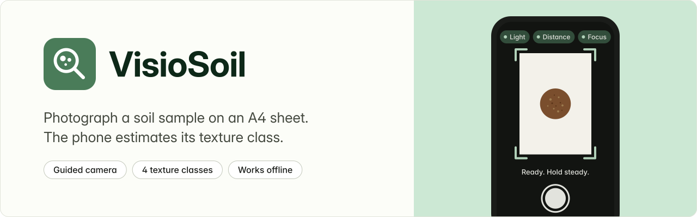

<p align="center"></p>

[](https://dart.dev)
[](https://flutter.dev)
[](https://github.com/LukeSantossz/visiosoil-app/actions/workflows/ci.yml)
[](LICENSE)

# VisioSoil: Geolocated Soil Texture Analysis

> A Flutter app that turns a phone photograph of a soil sample on an A4 sheet into a georeferenced record with an estimated texture class, computed on the device and kept on it.

## What It Does

VisioSoil lets an agronomist photograph a soil sample in the field, record where it was taken, and get an estimate of its texture class without a network.

- **Guided capture.** An in-app camera reads the A4 sheet live and shows chips for light, distance and focus before the shutter fires ([ADR 0028](docs/adr/0028-capture-uses-an-in-app-camera-that-reads-the-sheet-live.md)). The system camera remains as a fallback. Gallery import is not offered, by design.
- **Location.** Each record keeps the GPS fix, its reported accuracy and a reverse-geocoded address. EXIF metadata is stripped when the photo is stored, so the original location tags never persist.
- **On-device texture estimate.** The photograph is measured from the A4 sheet, cut into patches of fixed physical size and scored against a released contract of numbers, `assets/models/spec.json`, into one of four texture classes ([ADR 0024](docs/adr/0024-the-descriptor-path-is-the-v1-classifier-computed-in-dart-from-a-contract-of-numbers.md)). A photograph the reader cannot measure is refused with a named cause, never scored at a guessed scale.
- **Catalogue.** History with paging, texture filters, search by address and sample name, multi-select, batch delete, side-by-side comparison of two records, and a zoomable photo viewer. The agronomist can name the sample and record its true class with "Corrigir".
- **Management tips.** Advisory tips composed on the device from a bundled corpus, each citing its source. The current corpus is published without human review, and every tip says so (see Known Issues).
- **Export and share.** Records export as a CSV, optionally with dates, approximate location and a `.zip` of photos. A single record shares as text plus photo, and precise coordinates go out only when the user opts in on that share.
- **Account.** Optional Google sign-in, with the session in secure storage, and account deletion from Settings.
- **Field use.** Light and dark themes, a "Modo Sol" with high contrast and larger text for sunlight, text scaling, reduced motion, and haptics on confirmations.

## What It Is

VisioSoil is a **cross-platform mobile app** (Android and iOS). It produces a persistent, georeferenced record of each soil sample with its estimated texture class, for fieldwork where connectivity is unreliable: capture, analysis and storage all run on the device. Two Python side-builds produce the assets the app reads and ship nothing at run time: `ml/` fits and releases the classifier contract, and `corpus/` builds the management-tips corpus.

## Tech Stack

| Layer | Technology |
| --- | --- |
| Language | Dart 3.12.1; Python 3.12 for the side-builds |
| Framework | Flutter 3.44.1 (Android and iOS), pinned to match CI |
| State and navigation | `flutter_riverpod`, `go_router` |
| Data layer | Drift on SQLite, schema v12 |
| On-device analysis | Texture descriptors computed in Dart in a separate isolate, scored with the `spec.json` contract; no ML runtime |
| Classifier fit | scikit-learn over 26 classical texture descriptors, in `ml/` |
| Corpus build | Local open-source models served by Ollama, in `corpus/` |
| Device | `camera` (guided camera), `image_picker` (system-camera fallback), `geolocator`, `geocoding`, `share_plus` |
| Auth | `google_sign_in`, `flutter_secure_storage` |
| Testing and CI | `flutter_test`, `pytest`, GitHub Actions |

## Architecture

```mermaid
flowchart LR
    Cam[Guided camera + GPS] --> Cap[Capture]
    Cap --> Inf[InferenceService<br/>descriptor path in an isolate]
    Inf --> Repo[SoilRecordRepository]
    Cap --> Repo
    Repo --> DB[(Drift / SQLite)]
    DB --> UI[Home, History, Details<br/>reactive streams]
    Corpus[(Bundled corpus)] --> Tips[CorpusResearchService]
    Tips --> UI
    ML[ml/ release fit] -. spec.json .-> Inf
    CB[corpus/ build] -. corpus.json .-> Corpus
```

Screens read Riverpod providers, which depend on abstract repositories and never on Drift types. The classifier and the corpus each reach the app through one tracked file, written by its Python side-build: `assets/models/spec.json` and `assets/corpus/corpus.json`. Deletes are soft, and a tombstone keeps only what a future sync needs.

## Engineering Decisions

Each decision is recorded, with its alternatives and reasons, in its ADR under [`docs/adr/`](docs/adr/).

| ADR | Decision | Status |
| --- | --- | --- |
| [0001](docs/adr/0001-research-agent-advisory-web-grounded.md) | Research agent is advisory and web-grounded | Retired, superseded by 0022 |
| [0002](docs/adr/0002-image-file-storage-and-lifecycle.md) | Captures are copied into app storage, and the repository owns the file | Accepted |
| [0003](docs/adr/0003-image-file-deletion-and-write-exclusivity.md) | The image file is deleted at tombstone time, after the commit | Accepted |
| [0004](docs/adr/0004-flutter-toolchain-version-single-source.md) | One pinned Flutter version, shared by CI and local work | Accepted |
| [0005](docs/adr/0005-strip-exif-at-image-storage-boundary.md) | EXIF is stripped at the image-storage boundary | Accepted |
| [0006](docs/adr/0006-disable-android-os-backup.md) | Android OS backup and device transfer are disabled | Accepted |
| [0007](docs/adr/0007-share-location-opt-in.md) | A share omits the location unless the user opts in | Accepted |
| [0008](docs/adr/0008-tflite-remains-the-mobile-inference-runtime.md) | TensorFlow Lite stays the only neural runtime | Amended by 0024 |
| [0009](docs/adr/0009-fixed-roi-and-heuristic-quality-gate-over-segmentation.md) | Target isolation is a fixed region plus a quality gate, not segmentation | Accepted, amended |
| [0010](docs/adr/0010-synthetic-image-generation-deferred-behind-a-measured-gap.md) | Synthetic image generation waits for a measured gap | Accepted |
| [0011](docs/adr/0011-classification-verdict-from-margin-and-mass.md) | Uncertainty is a four-state verdict from margin and mass | Accepted |
| [0012](docs/adr/0012-released-model-artifact-tracked-in-git.md) | The released classifier contract is tracked in git | Accepted |
| [0013](docs/adr/0013-local-first-model-monitoring.md) | Model monitoring stays on the device | Accepted |
| [0014](docs/adr/0014-petri-dish-capture-protocol-and-the-unresolved-scale-reference.md) | Collection on a fixed Petri-dish rig | Retired, superseded by 0016 |
| [0015](docs/adr/0015-classification-reports-a-named-failure-cause.md) | A classification reports an outcome and a named cause | Accepted |
| [0016](docs/adr/0016-dataset-is-the-existing-dish-archive-and-siltosa-is-out-of-v1.md) | The dataset is the existing dish archive, and Siltosa is out of the first model | Accepted |
| [0017](docs/adr/0017-scale-is-read-by-a-classical-operator-on-a-known-circle.md) | Scale is read from an object of known size, never guessed | Accepted |
| [0018](docs/adr/0018-model-sees-fixed-size-greyscale-patches-and-their-spread-is-a-quality-signal.md) | The model sees fixed-size greyscale patches, and their spread is a quality signal | Accepted |
| [0019](docs/adr/0019-a-dataset-version-is-a-build-product-and-nothing-under-it-is-versioned.md) | A dataset version is a build product and is not versioned | Accepted |
| [0020](docs/adr/0020-evaluation-is-repeated-group-k-fold-with-nested-selection.md) | Evaluation is repeated group k-fold with nested selection | Accepted |
| [0021](docs/adr/0021-the-transported-population-stays-in-training-and-out-of-every-test-side.md) | The transported population stays in training and out of every test side | Accepted |
| [0022](docs/adr/0022-research-agent-precompiles-a-reviewed-corpus-and-escalates-under-a-cap.md) | The research agent runs at build time and ships a corpus | Accepted, narrowed by 0023 |
| [0023](docs/adr/0023-the-corpus-is-built-by-local-open-source-models-and-tier-2-leaves-v1.md) | The corpus is built by local open-source models | Accepted |
| [0024](docs/adr/0024-the-descriptor-path-is-the-v1-classifier-computed-in-dart-from-a-contract-of-numbers.md) | The v1 classifier is descriptor arithmetic in Dart | Accepted |
| [0025](docs/adr/0025-the-dart-resample-reproduces-pillows-bilinear-byte-for-byte.md) | The Dart resample matches Pillow's BILINEAR byte for byte | Accepted |
| [0026](docs/adr/0026-the-first-play-release-waits-for-classification.md) | The first Play release waits for classification of real photographs | Accepted |
| [0027](docs/adr/0027-a-photograph-is-classified-from-four-patches-and-its-spread-needs-nine.md) | Classify from four patches | Withdrawn, never implemented |
| [0028](docs/adr/0028-capture-uses-an-in-app-camera-that-reads-the-sheet-live.md) | Capture uses an in-app camera that reads the sheet live | Accepted |

## Getting Started

### Prerequisites

- Flutter 3.44.1 with Dart 3.12.1. Another 3.x SDK rewrites `pubspec.lock` and `analysis_options.yaml` on `flutter pub get`.
- An Android emulator or device, or Xcode for iOS.
- Python 3.12, only to run the `ml/` or `corpus/` tests.
- [`mf`](https://github.com/LukeSantossz/my-framework) on `PATH`, only to commit: the hooks run its gates.

### Installation

```bash
git clone --recurse-submodules https://github.com/LukeSantossz/visiosoil-app.git
cd visiosoil-app
# On a clone made without --recurse-submodules:
# git submodule update --init

flutter pub get
# Generate the Drift code; it is not tracked
dart run build_runner build --delete-conflicting-outputs

# Once per clone, to commit: wire the commit-msg and pre-push gates
bash scripts/setup.sh
```

`.standards/` is a submodule holding the development standards the gates check against. Both hooks fail closed, so a missing `mf` refuses the next commit rather than passing it.

### Running

```bash
flutter run
```

### Tests

```bash
flutter analyze
flutter test

# Python side-builds, each in a Python 3.12 environment with its requirements.txt installed
(cd ml && python -m pytest tests -q)
(cd corpus && python -m pytest tests -q)
```

### Release Signing (Android)

No keystore is configured in this repository, so `flutter build apk --release` falls back to the debug key with a warning, and that APK is not distributable. `flutter build appbundle --release` refuses the debug key and fails naming `key.properties`, because the bundle's only consumer is Play (SPEC 0111). CI sets `VISIOSOIL_ALLOW_DEBUG_BUNDLE=true` to prove the bundle builds; it is not a switch for a shell profile.

To produce a release-signed build:

1. Generate a keystore, and back it and its passwords up. Losing the key means the published app can no longer be updated.

   ```bash
   keytool -genkey -v -keystore visiosoil-release.jks \
     -keyalg RSA -keysize 2048 -validity 10000 -alias visiosoil
   ```

2. Create `android/key.properties`, which is git-ignored:

   ```properties
   storePassword=<store password>
   keyPassword=<key password>
   keyAlias=visiosoil
   storeFile=C:/Users/you/visiosoil-release.jks
   ```

   It is a Java properties file, so a backslash is an escape character. On Windows, write `storeFile` with forward slashes or doubled backslashes.

3. Build, then read the signing certificate. Play takes the bundle; the APK installs directly on a device.

   ```bash
   flutter build appbundle --release
   keytool -printcert -jarfile build/app/outputs/bundle/release/app-release.aab

   flutter build apk --release
   apksigner verify --print-certs build/app/outputs/flutter-apk/app-release.apk
   ```

Never commit the keystore or `key.properties`.

## Project Structure

```
visiosoil-app/
├── lib/
│   ├── core/
│   │   ├── features/      # One folder per screen: capture (with the guided camera), history,
│   │   │                  #   details, compare, settings, onboarding, home, splash, ...
│   │   ├── services/      # InferenceService and the descriptor path, auth, research, region,
│   │   │                  #   image storage, share, sync engine
│   │   ├── database/      # Drift database, tables and migrations
│   │   ├── data/          # Repository interfaces and Drift implementations, sync contract
│   │   ├── theme/         # Palette, typography, spacing, motion and haptics tokens
│   │   └── widgets/       # Shared widgets, among them the brand mark
│   ├── models/            # SoilRecord and the value types around it
│   └── providers/         # Riverpod providers
├── assets/
│   ├── models/spec.json   # The released classifier contract (tracked)
│   └── corpus/            # The bundled management-tips corpus and its site grids (tracked)
├── ml/                    # Python: dataset ingestion, evaluation, release fit of spec.json
├── corpus/                # Python: the management-tips corpus build
├── site/                  # Privacy policy and account-deletion page, on GitHub Pages
├── docs/                  # specs/, adr/, design/, guides/, plans/, studies/
└── test/                  # Unit, widget, migration and repository-policy tests
```

## Project Status

**In development.** The current version is `3.0.0` (build 3), the first since the `v2.0.0` tag of 2026-05-03 (SPEC 0259). The first Play release is tracked in [#265](https://github.com/LukeSantossz/visiosoil-app/issues/265).

### Done

- [x] Guided in-app camera with live sheet reading and light, distance and focus chips
- [x] GPS capture with accuracy and reverse-geocoded address, and EXIF stripped at storage
- [x] Descriptor path into four texture classes, run in an isolate under a timeout, with the scale read from the A4 sheet and every refusal named. The preview offers a retry only after a timeout, an isolate failure or a computation error (SPEC 0105)
- [x] History, search, filters, batch delete, comparison, CSV export and per-share location opt-in
- [x] Management tips composed on the device from bundled corpus `2026.10.31.2`
- [x] Optional Google sign-in, account deletion, and the published privacy and account-deletion pages
- [x] Light, dark and "Modo Sol" themes, with text scaling and reduced motion honoured
- [x] Drift persistence at schema v12 with cumulative, tested migrations and soft deletes
- [x] Sync foundation: uuid, `updated_at`, tombstones, an outbox and `SyncEngine`
- [x] CI: analysis, the Dart, `ml/` and `corpus/` test suites, the standards gates, a release APK and app bundle, an unsigned iOS build, and a smoke boot of the release APK on Android API 34, 35 and 36

### Pending

- [ ] Classify real photographs taken to the capture protocol, before the Play release ([ADR 0026](docs/adr/0026-the-first-play-release-waits-for-classification.md))
- [ ] Have the management-tips corpus reviewed by an agronomist
- [ ] Build the corpus release endpoint, so a device can refresh the bundled snapshot
- [ ] Implement a sync backend and wire `SyncEngine` into the app
- [ ] Release-sign the Android build in CI, and sign the iOS build

## Known Issues & Limitations

- **Real field photographs are not reliably classified yet.** The A4-sheet reader is graded on synthetic scenes and on 31 real photographs from 2026-10-05: it finds the sheet on 26, refuses the other 5 by name, and none of the 26 reach the patch grid (24 at `soilRegionTooSmall`, 2 at `photographTooCoarse`) ([sheet reader on real photographs](docs/studies/ml/sheet-reader-real-photographs.md)). A labelled field session on 2026-10-19 took 54 photographs to the capture protocol; the app classified 5 and all 5 were correct, and refused the other 49 (47 at `photographTooCoarse`) ([classifier on field photographs](docs/studies/ml/field-photographs-2026-10-19.md)). The limit today is not refusal alone: among photographs that score, the classifier skews toward clay. On that session, every classified photograph was Argilosa or Muito Argilosa, and upsampling the coarse photographs still reads Media and Arenosa soils as Muito Argilosa (0 of 24 right across those classes) ([classifier on field photographs](docs/studies/ml/field-photographs-2026-10-19.md)). Photographs taken fully to the [capture protocol](docs/guides/capture-protocol.md) must still validate the path before the Play release ([ADR 0026](docs/adr/0026-the-first-play-release-waits-for-classification.md)), so no general accuracy on production captures is stated.
- **The corpus was published without human review.** Corpus `2026.10.31.2` holds five grounded cells built by a 7B local model, and says `humanReview: false`. Two tips that QA rejected were removed from it by hand (SPEC 0260). A grounding check can quote a real passage that does not support the tip, so every cell carries the advisory disclaimer until an agronomist reviews it.
- **The corpus cannot refresh.** There is no release endpoint yet, so a device reads only the bundled snapshot.
- **Records are not synced.** The sync foundation exists, but no backend is implemented and `SyncEngine` is not wired, so records live only on the device that made them.
- **Release builds are debug-signed.** `android/key.properties` is absent and CI has no keystore step, so neither the APK nor the bundle CI builds is distributable. iOS is compiled in CI without code signing and has no development team set.
- **Camera only.** Gallery import is not offered, so no photograph is classified without the guided frame (SPEC 0211).
- **`drift_flutter` is pinned to `>=0.2.0 <0.2.4`.** A newer version must be checked against the Drift code generation before the pin moves.

## Contributing

Branch from `main` as `type/short-description`, keep `flutter analyze` and `flutter test` green, and write single-line Conventional Commits (`type(scope): subject`). A change of any substance starts with a spec under `docs/specs/NNNN-<slug>.md`, approved before the code. Run `mf check` before pushing; it runs the same gates as the hooks. The binding standards live in `.standards/docs/standards/`. `CLAUDE.md` and `AGENTS.md` are generated from them and from `docs/agents/project.md`, so edit that file and never the generated ones.

## License

[MIT](LICENSE)
